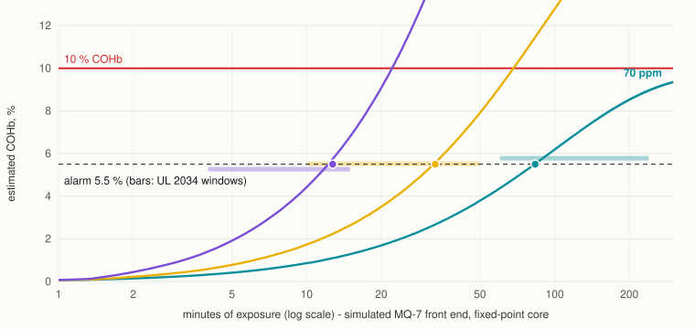
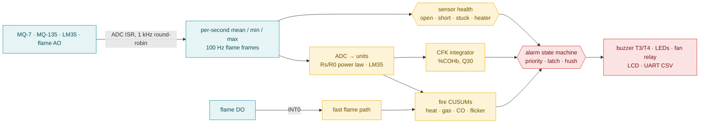

<!-- ════════════════════════════════════════════════════════════════════ -->
<!--                               HALDANE                                 -->
<!-- ════════════════════════════════════════════════════════════════════ -->

<div align="center">

<!-- animated banner — hand-built SVG + SMIL -->


<br/>

[](LICENSE)
[](#-hardware)
[](#-how-it-works)
[](#-reproduce-the-results)
[](#-specs-honest)
[](#-contributing)

**A bare-metal ATmega32 safety node that alarms on what the air is doing to your body, not on raw ppm.**
It estimates the occupant's blood carboxyhaemoglobin in fixed point, in real time, and alarms inside the UL 2034 windows.

[What is it](#-what-is-it) · [🔬 The idea](#-the-idea) · [📊 Results](#-results) · [🛠 How it works](#-how-it-works) · [🔩 Hardware](#-hardware) · [🚀 Run it](#-run-it) · [❓ FAQ](#-faq)

</div>

> [!WARNING]
> **HALDANE is a research prototype, not a certified life-safety device.** It has not been tested against UL 2034, EN 50291 or EN 54, and every result below comes from simulation with a synthetic sensor model. Do not rely on it to protect anyone. Use a listed CO alarm and smoke alarm.

---

## 🛰 What is it?

Carbon monoxide hurts you by binding to haemoglobin. What matters is how much of your blood is carrying CO (the **COHb** level), and that depends on *how long* you breathed *how much*. A cheap CO alarm ignores this. It trips when the ppm number crosses a line, so it screams every time someone fries an egg on a gas stove, and people learn to pull the battery.

**HALDANE runs the physiology instead.** An ATmega32 with no HAL and no floating point integrates the Coburn-Forster-Kane equation every second, from the CO history, and tracks the estimated COHb of a worst-case occupant. A five-minute cooking spike barely moves it. A real leak keeps pushing it up until it alarms, inside the time windows UL 2034 sets for residential CO alarms.

It is also what the original project promised: flame, CO, air-quality and temperature sensors on the ADC, threshold-based alert logic, interrupt-driven sampling, GPIO outputs, an LCD and UART telemetry. It is named after J. S. Haldane, whose experiments on CO and haemoglobin started this field. *Formerly Smart Home Security & Safety System.*

---

## 🔬 The idea

**Claim (falsifiable, simulated):** a 32-bit fixed-point CFK integrator on an 8-bit MCU, alarming at **5.5 % estimated COHb** for a heavy-exertion adult, lands inside **all three UL 2034 windows in 90 of 90 simulated runs**. In the same simulator it raises **0 alarms across 84 typical gas-cooking events**, where a 50 ppm threshold raises 84.

Why it matters:

- **Fewer nuisance alarms, same protection.** A dose-aware alarm can ignore short spikes and still be fast for dangerous exposures.
- **It fits on 8 bits.** Flash is 17.4 KB of 32 KB, static RAM 630 B of 2 KB, in the real avr-gcc build.
- **It exposes a gap in the usual story.** Manufacturer manuals describe the UL 2034 points as tied to ~10 % COHb. With textbook CFK parameters, a single 10 % threshold *cannot* meet the 70 ppm window. The 70 ppm steady state is only 9.87-10.00 % COHb, so 10 % is reached late or never. The thresholds that do satisfy all three windows form a band that moves with activity, from 1.8-2.7 % at rest to 4.5-7.7 % at heavy exertion (details in [docs/CFK.md](docs/CFK.md)).

**Related work.** The CFK equation comes from Coburn, Forster & Kane (J Clin Invest, 1965). The non-linear form used here, with O₂Hb = Hbmax − COHb, was validated against human exposures by Peterson & Stewart (J Appl Physiol, 1975). The Haldane constant goes back to Douglas, Haldane & Haldane (J Physiol, 1912) and to Haldane's CO experiments (J Physiol, 1895). CUSUM change detection, used in the fire detector, is from Page (Biometrika, 1954). Estimating COHb inside a detector is not new. US 5,764,150 (1998) and US 7,408,473 (2008) both describe it, the second with a simplified fixed-point recursion and thresholds of 6.5-9 %. What HALDANE adds is an open, tested implementation of the full non-linear CFK equation in 32-bit fixed point, with every parameter exposed and the UL windows checked end to end. Standards referenced: UL 2034, EN 50291, EN 54.

---

## 📊 Results

All numbers come from `python tools/run_all.py` → [`results/co_eval.json`](results/co_eval.json), plus `python tools/firmware_size.py` → [`results/firmware_size.json`](results/firmware_size.json). **Simulated:** the real C core runs through ctypes, but the MQ-7 front end, with heater cycling, 20 s response and noise, is synthetic.

**UL 2034 windows** (30 runs per level, exposure starting at evenly spread MQ-7 heater phases):

| CO step | UL window | HALDANE alarm (min · median · max) | Inside | Instant 50 ppm | 15-min mean ≥ 50 ppm |
| --- | --- | --- | :---: | --- | --- |
| 70 ppm | 60-240 min | 82.9 · 83.4 · 84.1 min | **30/30** | 2.1 min (0/30 inside) | 12.7 min (0/30) |
| 150 ppm | 10-50 min | 32.5 · 33.0 · 33.6 min | **30/30** | 1.8 min (0/30) | 7.0 min (0/30) |
| 400 ppm | 4-15 min | 12.2 · 12.7 · 13.4 min | **30/30** | 1.6 min (0/30) | 3.9 min (14/30) |

<div align="center">

<br><sub>Estimated COHb at the three UL test levels, produced by <code>haldane.eval_co</code>. Bars mark each UL window, dots the median alarm time.</sub>
</div>

**Nuisance and long exposures:**

| Scenario | HALDANE | Instant 50 ppm | 15-min mean ≥ 50 ppm |
| --- | --- | --- | --- |
| 30 ppm for 30 days (UL: no alarm) | no alarm, peak 4.51 % | no alarm | no alarm |
| 200 ppm for 5 min, 10 runs | **0 alarms** (peak 1.38 %) | 10 alarms | 8 alarms |
| 4 weeks of typical gas cooking: 84 events, 50-150 ppm, 3-12 min | **0 alarms** (peak 3.58 %) | 84 | 76 |
| 4 weeks of heavy cooking: 84 events, 100-300 ppm | 11 alarms (peak 6.55 %) | 84 | 84 |

**Real hazards (time to alarm):** slow leak 0→150 ppm over 2 h: 92.9 min (fixed thresholds: 41.9 / 49.4 min). 600 ppm step: 9.0 min (1.9 / 3.2). Furnace cycling 250/20 ppm: 19.5 min (1.9 / 5.0). HALDANE is slower than a ppm threshold by design, since it waits for the dose to matter. That is the trade-off.

**Robustness and accuracy:**

- Calibration (gain) error: the UL windows and the 30-day test still pass for CO readings between **0.9x and 1.2x** true. At 0.8x the 400 ppm alarm comes too late, and at 1.3x the 30 ppm steady state crosses 5.5 %.
- Fixed point vs a float RK4 reference: worst **0.0017 %COHb** over 8 h, across 4 activity presets × 4 exposures. The target was 0.1 %.
- Sensitive profile (alarm at 3.3 % plus a 250 ppm override), checked against the EN 50291 points: 50 ppm alarmed at 63.6-64.7 min (window 60-90, 10/10). 100 ppm at 28.4-29.6 min (10-40, 10/10). 30 ppm gave no alarm before 120 min (10/10). 300 ppm alarmed within 3 min in only **8/10** runs, because the MQ-7's 150 s heater cycle limits how fast CO can be read.

---

## ✨ Features

<table>
<tr>
<td width="33%" valign="top">

### 🩸 COHb alarm
A fixed-point CFK integrator (Q30 state, 32×32→64 products, a shift-subtract divider) tracks a worst-case occupant every second. Alarm at 5.5 %. A silent pre-alarm at 3 % starts the exhaust fan.

</td>
<td width="33%" valign="top">

### 🔥 Fused fire detector
Kept deliberately simple. CUSUMs on temperature rise, MQ-135 gas index, CO rise and flame flicker energy (2-15 Hz from 100 Hz samples) are fused into flaming and smouldering rules. Fixed 57 °C and 8.3 °C/min backups. An INT0 flame fast path.

</td>
<td width="33%" valign="top">

### 🧪 Sensor health
Open, short and stuck checks run per channel from the per-second min/max of 1000 samples. An MQ-7 heater check, a warm-up state, and latched watchdog and brown-out resets. A trouble chirp once a minute.

</td>
</tr>
<tr>
<td valign="top">

### 🌡 Proper MQ-7 driving
The datasheet heater cycle runs 60 s at 5 V, then 90 s at 1.4 V. Timer2 PWM at a 7.8 % duty gives 1.4 V-equivalent heater power, (1.4/5)². CO is read at the end of the low phase. Ratiometric Rs/R0 with power-law curves in fixed point, plus a clean-air calibration stored in EEPROM.

</td>
<td valign="top">

### 🚨 Alarm logic
Priorities are FIRE > CO > test > hush > pre-alarm > trouble. Fire sounds the temporal-3 pattern, CO the temporal-4. Alarm memory latches. Hush is refused for the heat backups, the fast flame path, or COHb ≥ 10 %. The fan relay turns off in a fire.

</td>
<td valign="top">

### 📟 Bare metal
Register-level code: a Timer1 1 kHz tick, a chained ADC-complete ISR, INT0, a UART TX ring, a 4-bit HD44780 driver, and a watchdog kicked only after a completed second. The firmware runs the exact core sources the tests run.

</td>
</tr>
</table>

---

## 🛠 How it works



Every box below the ADC is portable C99 in [`firmware/core`](firmware/core), integer only, with no target headers. The ATmega32 `main.c` and the host DLL both call the same `hd_node_flame_frame()`, `hd_node_flame_edge()` and `hd_node_second()`. The UART sends one CSV line per second: `t_s,co_ppm,cohb_pct,cohb_eq_pct,temp_c,gas_idx,flame,state,cause,faults,heater`.

---

## 🔩 Hardware

| Signal | ATmega32 pin | Notes |
| --- | --- | --- |
| MQ-7 AO | PA0 / ADC0 · **40** | module powered from the same 5 V as AVCC (ratiometric) |
| MQ-135 AO | PA1 / ADC1 · **39** | heater always on, needs 24 h+ preheat on first use |
| LM35 Vout | PA2 / ADC2 · **38** | add a pull-down so an open sensor reads 0 V and is flagged |
| Flame AO | PA3 / ADC3 · **37** | falls as IR rises on common modules (`flame_inverted`) |
| Flame DO | PD2 / INT0 · **16** | comparator output, active low |
| MQ-7 heater MOSFET gate | PD7 / OC2 · **21** | logic-level N-MOSFET, low side, 100 Ω gate + 100 kΩ pull-down |
| Relay (exhaust fan) | PD3 · **17** | NPN driver + flyback diode, or a relay module |
| Buzzer | PD4 · **18** | active buzzer through an NPN |
| Red / green LED | PD5 · **19** / PD6 · **20** | 330 Ω each |
| Test/hush button | PB2 · **3** | to GND, internal pull-up. Hold at power-up for clean-air calibration |
| LCD RS / E / D4-D7 | PC0 · **22** / PC1 · **23** / PC4-PC7 · **26-29** | HD44780 16×2, RW to GND. JTAG must be off |
| UART TX / RX | PD1 · **15** / PD0 · **14** | 38400 8N1 |
| Crystal | XTAL1/2 · **13/12** | 16 MHz + 2 × 22 pF |

**Fuses:** `lfuse 0x3F` (external crystal, brown-out detection on at 4.0 V) and `hfuse 0xC9` (CKOPT for 16 MHz, JTAG off, ISP on). Write them with `pio run -t fuses` or `make -C firmware/avr fuses`.

| Part | Qty | Rough price |
| --- | :---: | --- |
| ATmega32-16PU + 16 MHz crystal + caps | 1 | $4 |
| MQ-7 module | 1 | $3 |
| MQ-135 module | 1 | $3 |
| LM35DZ | 1 | $1.5 |
| IR flame sensor module (AO + DO) | 1 | $1 |
| HD44780 16×2 LCD | 1 | $3 |
| Logic-level MOSFET (e.g. IRLZ44N), 2× NPN, diodes, resistors | - | $2 |
| 5 V relay module, active buzzer, LEDs, button | - | $3 |
| 5 V 1 A supply (the MQ heaters draw ~300 mA together) | 1 | $3 |
| USBasp programmer | 1 | $3 |

---

## 📏 Specs (honest)

| Item | Value | Status |
| --- | --- | --- |
| MCU / clock | ATmega32, 16 MHz crystal, BOD 4.0 V, watchdog 2 s | built with avr-gcc 7.3; **not run on hardware yet** |
| Flash / static RAM | 17,370 B (53.0 %) / 630 B (30.8 %), leaving 1,418 B for the stack | measured from the real build |
| CO update rate | once per 150 s MQ-7 cycle | by design (datasheet heater cycle) |
| COHb integration | 1 s step, Q30, ≤ 0.0017 % vs float over 8 h | tested on host |
| UL 2034 windows | 90/90 simulated runs inside | **simulated only** |
| EN 50291 (sensitive profile) | 30/50/100 ppm points met; 300 ppm < 3 min in 8/10 runs | **simulated only** |
| CO accuracy | depends on the MQ-7 unit and calibration; windows hold for 0.9-1.2× gain | MQ-7 temperature and humidity drift **not modelled** |
| MQ-135 | used as a smoke/VOC rate channel only. It is **not CO₂-selective**, and its "CO₂" curve is a rough datasheet fit | not validated |
| Fire detector | rules and backups unit-tested on synthetic signals | **no EN 54 fire tests, no scenario study** |
| Occupant model | one adult parameter set, 4 activity presets | not individualised; not medical advice |
| Per-tick CPU load | not measured | estimate pending a simulator or scope |

---

## 🚀 Run it

<table>
<tr>
<td width="50%" valign="top">

### 🙂 For users

1. Build the circuit in the wiring table.
2. Flash with a USBasp: `pio run -t fuses` once, then `pio run -t upload`.
3. Power it up **holding the button** in clean outdoor-quality air. It calibrates both MQ sensors after warm-up (~8 min) and saves to EEPROM.
4. Watch the LCD, or open a serial monitor at 38400 baud for the CSV stream.

</td>
<td width="50%" valign="top">

### 🧑‍💻 For developers

```bash
git clone https://github.com/Zero-State-Logic/Haldane
cd Haldane
python tools/run_all.py        # build, C tests, Python tests, eval
python tools/run_all.py --no-eval
```

```bash
pio run                        # ATmega32 firmware (or: make -C firmware/avr)
python tools/firmware_size.py  # flash/RAM -> results/
make -C host test              # Linux/macOS host build + tests
```

</td>
</tr>
</table>

---

## 🧪 Reproduce the results

| Command | What it does | Output |
| --- | --- | --- |
| `python tools/run_all.py` | builds the core with MSVC (Windows) or `cc`, runs **54 C tests (1401 checks)** and **9 Python tests**, then runs the evaluation | `results/co_eval.json`, `docs/assets/cohb_ul_windows.svg` |
| `cd host && python -m unittest discover -s tests -v` | Python tests only (needs the DLL from the line above) | - |
| `cd host && python -m haldane.eval_co` | evaluation only, about 20 s | as above |
| `python tools/firmware_size.py` | PlatformIO build + `avr-size` | `results/firmware_size.json` |

Requirements: Python 3 with numpy, a C compiler (MSVC Build Tools on Windows via `tools/msvc.bat`, or `cc` elsewhere), and PlatformIO for the firmware.

---

## 📁 Project layout

```
Haldane/
├─ firmware/
│  ├─ core/        🧠 portable C99, integer only: CFK, calibration, MQ-7 schedule,
│  │                  sensor health, fire CUSUMs, alarm state machine, node
│  └─ avr/         🔌 ATmega32 drivers + main.c + Makefile (sampler ISRs, PWM, UART, LCD, EEPROM)
├─ host/
│  ├─ ctest/       🧪 C unit tests (tiny assert framework) + double CFK reference
│  ├─ capi/        🔗 ctypes DLL wrapper around firmware/core
│  ├─ haldane/     🐍 float CFK reference, synthetic MQ-7 front end, evaluation + chart
│  └─ tests/       ✅ Python unittest
├─ tools/          🛠 run_all.py, firmware_size.py, msvc.bat
├─ results/        📊 co_eval.json, firmware_size.json
├─ docs/           📐 CFK.md (model, parameters, the 10 % finding), assets/
└─ platformio.ini  ⚙️ bare-metal ATmega32 env (no framework)
```

---

## 🗺 Roadmap

- [x] Fixed-point CFK integrator, tracking float to < 0.002 % COHb
- [x] UL 2034 windows, 30-day and spike tests in simulation, against fixed-ppm baselines
- [x] Bare-metal ATmega32 firmware, building at 53 % flash / 31 % RAM
- [x] Simple fused fire detector with heat backups and an INT0 fast path (unit-tested)
- [ ] Bench test with a real MQ-7, a calibration gas and a reference CO meter
- [ ] Temperature and humidity compensation for the MQ sensors
- [ ] EN 54-style fire scenario library (smouldering and flaming test fires, nuisance sources) to tune and evaluate the fire rules
- [ ] Electrochemical CO sensor option (faster and more selective than the MQ-7)
- [ ] Per-tick cycle measurement in simavr or on a scope

---

## 🤝 Contributing

**Students and first-time contributors are welcome.** The most useful contributions right now are real-hardware measurements: MQ-7 curves, heater-cycle traces, a run next to a listed CO alarm. The core is one folder of plain C with host tests, so you can change the model and see the effect in seconds. Open an issue or a PR.

---

## ❓ FAQ

<details>
<summary><b>Is this a medical device or a certified alarm?</b></summary>
<br>
No. It is a research prototype, evaluated only in simulation. The occupant profiles are configuration choices, not medical advice. Use a listed CO alarm.
</details>

<details>
<summary><b>Why not alarm at 10 % COHb like the manuals say?</b></summary>
<br>
With standard CFK parameters, 70 ppm settles at about 10 % COHb, so a 10 % threshold would alarm hours late or never, outside the 60-240 min window. The thresholds that fit all three UL windows sit between 4.5 % and 7.7 % for an exercising adult. HALDANE uses 5.5 %. See <a href="docs/CFK.md">docs/CFK.md</a>.
</details>

<details>
<summary><b>Whose COHb is it estimating?</b></summary>
<br>
A reference adult at heavy exertion, the fastest-uptake case among the presets. Anyone resting in the same room is lower. The model knows nothing about the actual people present.
</details>

<details>
<summary><b>Isn't it slower than a normal CO alarm?</b></summary>
<br>
Yes, for low and moderate levels. That is the point: UL 2034 itself forbids alarming at 70 ppm before 60 minutes. For very high levels, the sensitive profile adds an immediate ppm override.
</details>

<details>
<summary><b>Does the MQ-135 measure CO₂?</b></summary>
<br>
No. It responds to many gases and to humidity. HALDANE only uses how fast its reading rises, as smoke/VOC evidence for the fire rules.
</details>

---

## 📜 License

MIT. Free for everyone, for any use, forever. See [LICENSE](LICENSE).

## 🙏 Acknowledgements

Built with avr-gcc, avr-libc and PlatformIO. The MQ power-law constants are the datasheet-curve fits distributed with the open-source MQUnifiedsensor library. The physiology stands on Coburn, Forster & Kane, on Peterson & Stewart, and on J. S. Haldane's CO experiments.

<div align="center">
<br>
<b>If you care about safety hardware that is honest about what it knows, star the repo and help test it on real sensors.</b>
<br><br>
<sub>HALDANE · alarms on what the air does to your blood</sub>
</div>
